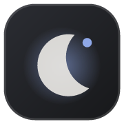
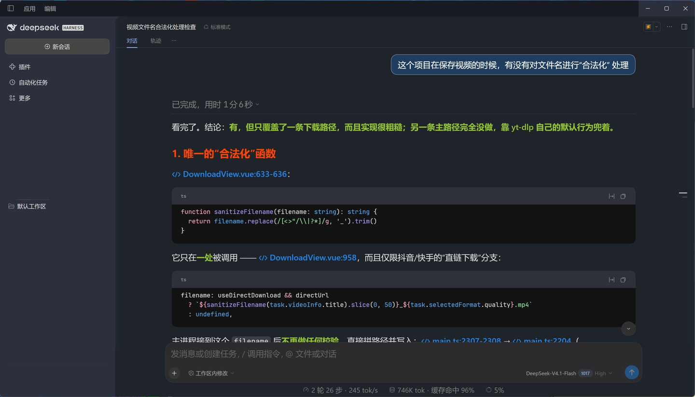

# CoolDark



给 **DSH**（DeepSeek Harness）用的低对比度深色主题。

不纯黑、不偏暖、不刺眼——画布是中性暗灰，正文是柔和的浅灰。长时间盯对话和代码，眼睛不容易累。



## 安装

前提只有两条：**能访问 github.com**，以及已装好 DSH（`dsh` 在 PATH 里）。不需要另外装 Node 或 pnpm，dsh 自带。

**Web 端**

```sh
dsh plugin add github:CC-play/dsh-theme-cooldark
```

**桌面端**

```sh
dsh plugin --profile desktop add github:CC-play/dsh-theme-cooldark
```

装完先别急着重启，先到【设置】→【插件市场】→【已安装】里把它的开关打开：

> **看到「已安装，未生效」是正常的，不是装失败。**
> `dsh plugin` 只把包放进 `node_modules`，不会自动登记进插件清单。在那一条上把开关打开即可。

然后**完全退出 DSH 再启动**（托盘图标也要退掉），光刷新页面不够——浏览器端的插件清单只在页面加载时下发一次。

重启后在同一个位置能看到它已启用。禁用即恢复官方主题，不用卸载。

## 它做了什么

- **分层底色**：画布、侧栏、浮层按 10 级暗灰色阶排开，一眼能看出层级
- **聊天气泡**：半透明 DodgerBlue 底 + 淡白描边，用户消息和正文分得开
- **代码块**：比画布更沉的黑井，顶部语言条抬出来另给一色，两者有明确分界
- **Markdown**：h1–h4 各有标题色，列表 marker 上色，粗体橄榄绿，行内代码半透明洗色
- **输入框**：聚焦时一圈柔和白光

## 它不碰的东西

**字号和字体归「设置」管**，主题不接管。你在设置面板里调多大，就是多大——改字号不会把主题弄丢，切主题也不会覆盖你的字号。

## 装了但没变化？

按顺序看：

1. **没彻底重启。** 进程退干净再开，包含托盘图标。
2. **开关过又开回来。** 市场的「关 → 开」只热挂载 Host 半边，不会补发浏览器端模块，按 `Ctrl+R` 刷新页面。
3. **安装时卡在 `ECONNRESET`。** 下载阶段连不上 github.com。npm 依赖可以走镜像，但 git 依赖直连 GitHub，镜像加速不到。网络恢复后重跑安装命令即可，不必先清理。

## 许可

MIT
